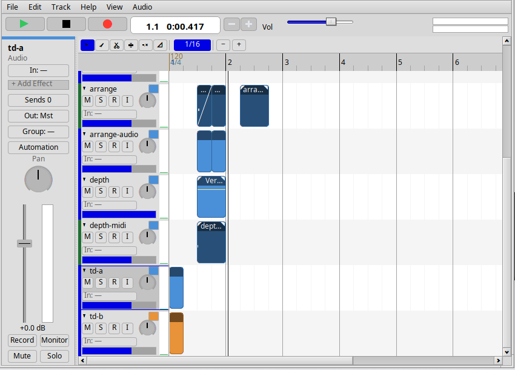
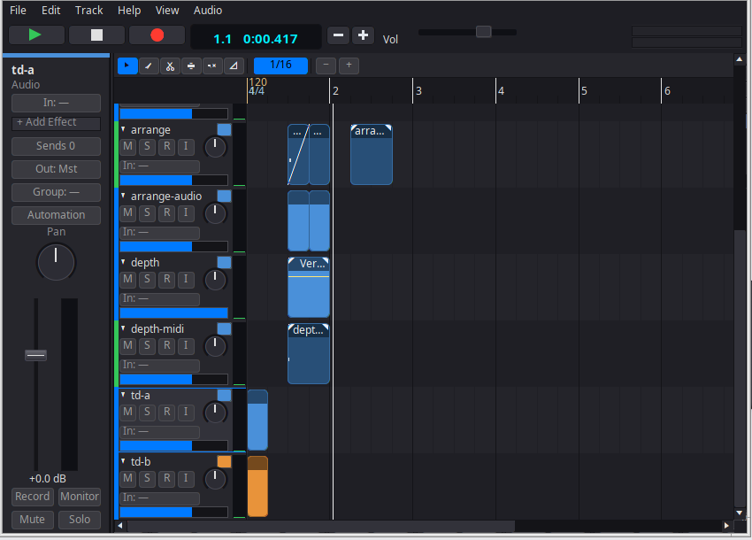

# Haiku DAW

A native digital audio workstation for [Haiku](https://www.haiku-os.org/):
multitrack audio and MIDI recording, editing and mixing on a timeline, with
buses and sends, automation, built-in and LV2 effects, a synth and a
soundfont sampler, and offline export.

It is written in C++17 against the Haiku kits — Media Kit for audio I/O and
playback, Midi Kit 2 for MIDI endpoints, Interface Kit for the windows — and
not ported from anywhere. The model, DSP and file-format layers are kit-free
and unit-tested on any host; only the engine and the UI need Haiku.

[](LICENSE)
[](https://www.haiku-os.org/)
[-orange.svg)](CHANGELOG.md)

| The system look | The DAW's dark mode |
|---|---|
|  |  |

## What it does

**Timeline and editing**
- Clips with drag, move, trim, split, slip-edit and nudge; fades drawn by
  dragging the top corners, with equal-power crossfades applied automatically
  where clips overlap. Per-clip name, colour, gain, mute.
- Stretch to fit: **Cmd**-drag (or **Alt**-drag) a clip's right edge and it
  time-stretches (WSOLA), keeping its pitch, with the ratio drawn on the clip.
- Multi-select (rubber-band or Cmd-click) with group move, delete and
  duplicate; a time range that is independent of the clips, with Cut, Copy,
  Paste, Delete and Insert Silence.
- Region operations — normalize, reverse, strip silence, clear fades — and
  track freeze render on a worker thread with progress and a Cancel, so a long
  decode never blocks the window.
- Tempo and meter map with ramps; the grid, ruler, snap, metronome and piano
  roll all follow it. Markers, a marker lane, loop and punch regions.
- Undo and redo for every edit: the command stack is the only way the model
  changes, and each menu entry carries the name of the edit it undoes.

**Recording**
- Audio takes at the device's native rate, resampled to the project: count-in,
  overdub, punch-in/out, loop recording with take comping, input monitoring.
- Multichannel input: a track is mono or stereo and takes an input device and
  channel pair from the inputs the system reports — two armed tracks can record
  two different channels of one interface in the same pass, one take each.
  Takes are written as 16-bit, 24-bit or 32-bit float.
- Round-trip latency compensated from what the Media Kit reports for the
  device. Takes are never overwritten — each new one takes the next free name.

**MIDI**
- A piano roll with velocity and CC lanes and a tool palette (pointer, pencil,
  brush, eraser, scissors, glue, velocity).
- An instrument per track: an internal synth, or an SFZ/SF2 soundfont sampler.
- Sustain (CC64) latches notes while the pedal is down; pitch-bend and the mod
  wheel modulate the synth and the sampler, live and on playback. The CC lane
  offers any of the 128 controllers, labelled where the name is known.
- External MIDI input from any published Midi Kit 2 producer, assigned per
  track; SMF import and export.
- Transforms: quantize (grid, strength, swing, note ends), humanize, legato,
  transpose, velocity — each one undo step.

**Mixing and routing**
- Per-track fader, pan, mute, solo, mute groups, solo-safe; buses; aux sends
  with pre- or post-fader taps; master bus effects; monitor dim and mono.
- Mixer strips: insert slots, send levels, input trim and phase invert, solo
  groups, and dB entry by double-clicking the fader or its value.
- Per-track meters and a BS.1770 loudness meter (momentary and short-term
  LUFS, true peak).
- Automation for volume, pan and every effect parameter, drawn on the
  timeline.
- Plugin delay compensation in the engine and in the offline renderer,
  including a plugin whose reported latency *changes* while it runs: the host
  observes the port, re-latches and re-solves compensation without stopping
  playback (the documented cost is one brief re-alignment when it moves).
  Gain staging includes track freeze.

**Effects and plugins**
- Built-ins: 5-band parametric EQ with a spectrum display, biquad filter,
  compressor, gate, reverb, delay, saturator, stereo widener and a look-ahead
  limiter. The compressor and gate take a sidechain key from any other track,
  and an LV2 plugin with sidechain inputs is keyed the same way.
- Insert slots with bypass and wet/dry per slot.
- A native add-on ABI for Haiku shared objects ([src/plugin/](src/plugin/)), plus
  **LV2** hosting through lilv: a plugin browser, plugin state saved into the
  project, presets from the insert slot, and a plugin's own editor opened in a
  window and driving the playing insert.

**Export**
- Mixdown or stems; the whole project or the loop range.
- WAV (16/24-bit PCM, 32-bit float), FLAC (16/24-bit) and Ogg Vorbis; TPDF
  dither for 16-bit; loudness normalization to a target LUFS with a true-peak
  ceiling and an optional look-ahead limiter.
- Exporting at another sample rate resamples through a windowed-sinc filter
  (Kaiser, 192 taps): aliases and images more than 100 dB down, the passband
  flat to a hundredth of a dB. Import sniffs the format from the header, so
  WAV, AIFF, FLAC and Ogg all open the same way.
- Rendered on a worker thread with a progress bar you can cancel; a cancelled
  export leaves nothing behind. Separate SMF export for MIDI.

**Files and the application**
- A transport bar with the full button row — return-to-zero, rewind,
  fast-forward, play, stop, record, loop, click and punch, each showing its
  state — a large time display that cycles bars:beats, min:sec, samples and
  timecode and accepts a typed position, tempo and meter, a DSP-load peak hold
  with an xrun counter, and a status line.
- A **Preferences** window (buffer size, default sample rate, count-in,
  metronome sound and level, monitor input, dark mode, UI scale, default
  project folder, autosave interval) and **Project Settings** (sample rate with
  an optional resample of the media, tempo, meter, notes).
- **File ▸ New** offers templates — Empty, Band and Producer — from `.dawproj`
  files installed with the app.
- One text `.dawproj` file with media paths relative to it, so a project and
  its takes move together. The type is registered with the MIME database, so
  Tracker double-click and drag-onto-the-app both open it; the app is
  single-launch.
- Autosave with crash recovery, Open Recent, and a Save/Discard/Cancel prompt
  whenever unsaved work is at risk.
- An inspector pane (`I`) and a dockable editor/browser pane (`J`); a sample
  browser over BFS attributes and live queries; a keyboard-shortcuts window.
- Native Haiku look by default, or the DAW's own dark palette (Preferences ▸
  Dark Mode) applied to its own windows. It never changes the operating
  system's appearance.

## Requirements

- **Haiku R1/beta5 or newer** (developed on R1/beta6).
- **CMake 3.16+** and a C++17 compiler: `pkgman install cmake gcc`.
- **Optional, for LV2 hosting:** `pkgman install lilv lilv_devel lv2`.
- **Optional, for compressed audio:** `pkgman install flac_devel libvorbis_devel`.
  Both are auto-disabled when the libraries are missing: the format is then
  simply not offered (never offered and then broken).

Without LV2 the build has no LV2 support; everything else is unaffected.

## Building

On Haiku:

```sh
cmake -S . -B build
cmake --build build -j4
./build/daw
```

The binary is self-contained: its signature, version and file types ride
inside it as an application resource, so there is nothing to install beside it.
A bare launch starts a demo session; a project can also be handed in:

```sh
./build/daw --version
./build/daw ~/Music/mysong.dawproj
```

Useful options:

| Option | Default | Effect |
|---|---|---|
| `DAW_LV2` | `ON` | Host LV2 plugins through lilv (auto-off when lilv is absent) |
| `DAW_FLAC` | `ON` | Read and write FLAC (auto-off when libFLAC is absent) |
| `DAW_VORBIS` | `ON` | Read and write Ogg Vorbis (auto-off when libvorbis is absent) |
| `DAW_SANITIZE` | `OFF` | Build with ASan/UBSan |

On another host, CMake builds only the kit-free model, DSP, format and engine
logic plus the host test suite — which is the fast iteration loop for all of
the above:

```sh
cmake -S . -B build-host
cmake --build build-host -j4
ctest --test-dir build-host
```

## Testing

- **Host suite** — `ctest --test-dir build-host`: 75 test binaries covering
  the model, undo, project I/O, WAV/AIFF/FLAC/Ogg readers and writers,
  resampling (linear and windowed sinc), tempo map, DSP, effects, sidechain,
  sampler, MIDI, routing, PDC, time-stretch, export, and fuzz corpora for the
  parsers. No display, no audio device, about two seconds.
- **On Haiku** — `ctest --test-dir build` adds the engine, Midi Kit and UI
  suites. `ui_functional_tests` drives the real windows by posted messages and
  **skips (exit 77)** where there is no app_server rather than passing a
  window that never opened.

A UI change is not finished when the tests are green: the screenshot pass
(`DAW_UI_SHOTS=<dir> ./ui_functional_tests`, once per theme mode) has to be run
and every shot looked at. The rules are in [docs/UI_GUIDELINES.md](docs/UI_GUIDELINES.md),
and they exist because a milestone once merged with 172 green checks and a
visibly broken main window.

## Documentation

| Document | What is in it |
|---|---|
| [docs/USER_GUIDE.md](docs/USER_GUIDE.md) | The tour of the app — window, recording, editing, mixing, export |
| [docs/ARCHITECTURE.md](docs/ARCHITECTURE.md) | Design of record: layers, threading, the audio path, the model |
| [docs/HANDOFF.md](docs/HANDOFF.md) | Milestone history, the build, the host ⇄ VM dev loop, hard-won lessons |
| [docs/HAIKU_CONFORMANCE.md](docs/HAIKU_CONFORMANCE.md) | How it uses each Haiku kit, and where it conforms or deliberately does not |
| [docs/UI_GUIDELINES.md](docs/UI_GUIDELINES.md) | The rules for anything under `src/ui/`, including the screenshot pass |
| [docs/PLAN_1.0.md](docs/PLAN_1.0.md) | The remaining work to 1.0, milestone by milestone |
| [docs/ROADMAP.md](docs/ROADMAP.md) | Phases already landed, and what is deferred |
| [docs/RELEASE_CHECKLIST.md](docs/RELEASE_CHECKLIST.md) | The hardware-only pass a release needs |
| [CHANGELOG.md](CHANGELOG.md) | What is in 1.0 |

## Project layout

```
src/model/     kit-free model: project, tracks, clips, notes, tempo map, commands
src/dsp/       kit-free DSP: effects, meters, sidechain key, smoothing
src/engine/    audio engine: graph, streaming, recording, offline export
src/midi/      Midi Kit 2 adapter (endpoints and input)
src/synth/     internal synth and the SFZ/SF2 sampler
src/plugin/    native add-on ABI, LV2 host, sample plugin
src/storage/   BFS attributes and live queries for the sample browser
src/ui/        windows, timeline, piano roll, mixer and the drawn widget kit
tests/         the test suite (host + Haiku targets)
scripts/       the host ⇄ VM dev loop and the probe scripts
prototypes/    standalone spikes, not part of the app
```

## Status

**1.0.0, unreleased.** The 1.0 plan has landed — the UI foundation, the
arrange-window work, the transport/mixer/preferences layer, multichannel input,
the compressed formats, time-stretch, sidechain and the engine-responsiveness
items are all in ([docs/PLAN_1.0.md](docs/PLAN_1.0.md) carries the per-item
status). What is left before the tag is the release itself: the packaging pass,
Marc's hardware pass over
[docs/RELEASE_CHECKLIST.md](docs/RELEASE_CHECKLIST.md), and the tag. Until then
the version string says 1.0.0 and the changelog heading says unreleased.

## Known limitations

- **No pitch-shift.** Time-stretch is in (Cmd-drag a clip's right edge, or
  Alt-drag); it keeps the recorded pitch, and the last few milliseconds of a
  stretched clip that ends mid-file are windowed down rather than continued
  into the material after it.
- **Of the 128 MIDI controllers, six are audible** — CC1 (mod wheel), CC7,
  CC10, CC11, CC64 (sustain) and pitch-bend. Any other controller can be
  recorded, drawn, saved and exported, but nothing listens to it yet, and live
  controller moves are engine-wide rather than per input device.
- **VST is not supported**, by design — LV2 is the plugin format here.
- **AIFF is read-only**; writing is WAV, FLAC and Ogg Vorbis.
- **Output device selection is not in this release.** Audio goes to the system
  default output, and the Preferences row for it is disabled; the plan item for
  it (`docs/PLAN_1.0.md`, M5.3) did not land.
- **One capture comes from one audio device.** Track inputs are enumerated and
  assigned per track by name, mono or stereo, but a recording pass reads the
  devices' channels from a single input node; recording two interfaces at once
  is not supported.
- **USB audio interfaces**: support is whatever Haiku's Media Kit drives. The
  HD Audio driver is what this is developed and tested against, and Haiku's
  `usb_audio` driver supports USB audio class 1 only (as of R1/beta6).
- **No video, notation, cloud or collaboration** — non-goals, not gaps.

## Development

The development loop, the VM, the build and test commands and the rules every
change follows are in [docs/HANDOFF.md](docs/HANDOFF.md) and
[AGENTS.md](AGENTS.md). In short:

- Implement kit-free logic first (`src/model`, `src/dsp`, format and engine
  helpers) with host tests; Haiku-only code is verified on Haiku.
- Every fix ships a regression test.
- UI work follows [docs/UI_GUIDELINES.md](docs/UI_GUIDELINES.md), including
  the screenshot pass.
- Commits use conventional-commit subjects.

## License

MIT — see [LICENSE](LICENSE). © 2026 Marc Korte.

Built on Haiku and its kits; LV2 hosting uses [lilv](https://drobilla.net/software/lilv)
and compressed audio uses libFLAC and libvorbis.
